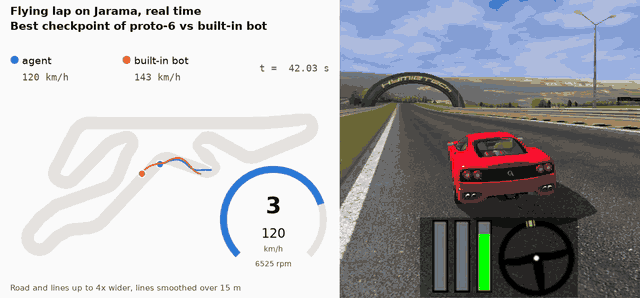
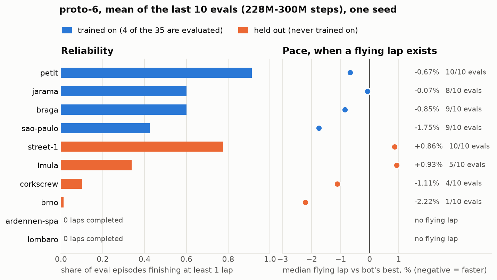
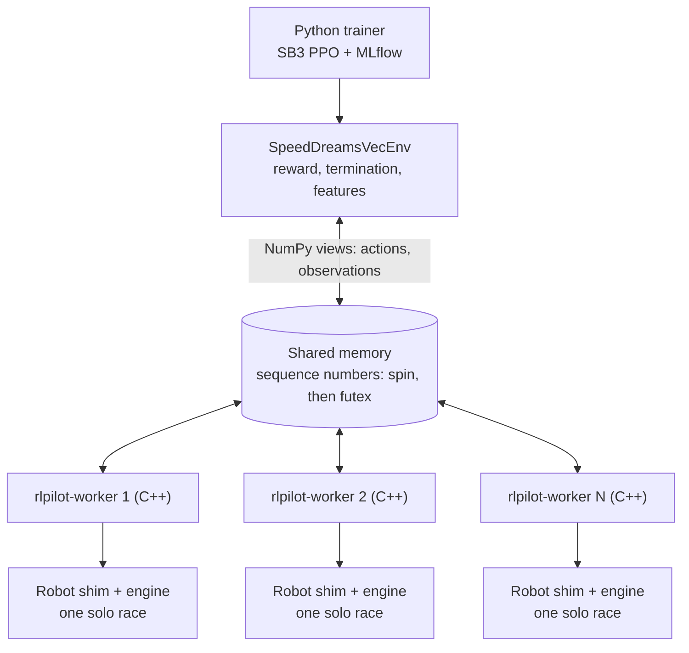
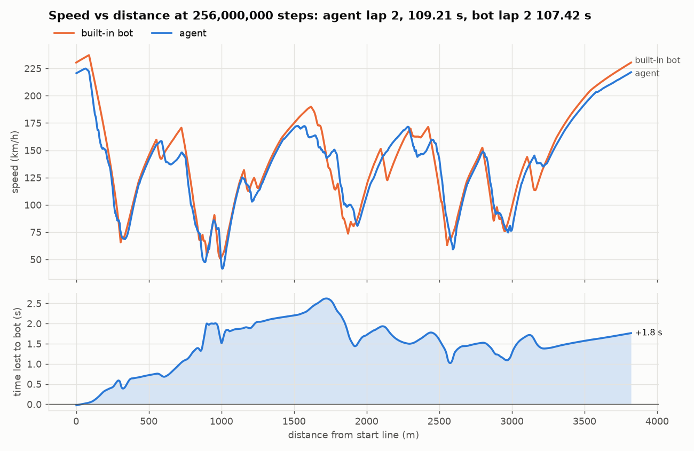

# rlpilot


I wrote a custom Gymnasium vector environment over a headless racing simulator (Speed Dreams, a TORCS fork) and used it to train a PPO driver across 35 tracks on a laptop. The native layer runs **167k env steps/s (about 3,350x real time)** without Python, and the full PPO loop trained 300M steps in about 7 h 10 min.



*40 s of a flying lap on Jarama from the best checkpoint of my latest run, replayed in the game from its exact recorded controls, with the built-in bot on the synced map. This lap took 108.27 s against the bot's 107.42 s. It's a good lap, not a typical one: the agent isn't reliable yet (see [Results](#results)) and its inputs are [jittery](#status-and-limits). On the map, road and lines are drawn up to 4x wider and lines are smoothed over 15 m; track length and shape are to scale.*

## At a glance

| Area | Techniques |
|---|---|
| RL | PPO (Stable-Baselines3), MLP policy, reward components logged separately, potential-based reward shaping, domain randomization (tyre grip, mass, engine power), action std clamping, `target_kl` early stopping, linear LR decay |
| Simulation and systems | Headless C++ worker host over the engine, one process per simulator, a robot module shim, ray casting over track geometry, in-process race restarts, worker recycling around an engine memory growth |
| Performance engineering | One shared-memory block with atomic sequence numbers, spin-then-futex wait (`os_sync_wait_on_address`), one native call per vector step, batched NumPy reward and observations, tuning of workers, spin time and torch threads |
| Evaluation | Deterministic policy against a built-in bot on the same track, held-out tracks, launch-noise episodes, per-track metrics, windowed checkpoint selection |
| Tooling | MLflow (SQLite store, run provenance with git SHAs, per-eval plots and traces), pytest, CMake, uv, reproducible build script |

## Results

The results below come from my MLflow store, exported to [`docs/data/results_by_run.csv`](docs/data/results_by_run.csv) and [`results_by_track.csv`](docs/data/results_by_track.csv). The last run is from 2026-10-09.

### Driving

All numbers are means over a run's **last 10 evals**, because a single eval is noisy and my `best/` checkpoint was selected using the held-out tracks. Each eval runs 8 episodes per track with the stock car.

| Run | Trained on | What changed | Finishes a lap: monitored training tracks | Pace vs bot: training | Finishes a lap: held-out tracks | Pace vs bot: held-out (share of tracks with a flying lap) |
|---|---|---|---|---|---|---|
| proto-3 | 4 tracks | Curvature lookahead | 0.78 | -9.9% | 0.00 (2 tracks) | none |
| proto-4 | 35 tracks | Car randomization | 0.48 | -3.6% | 0.39 | -2.5% (47%) |
| proto-5 | 35 tracks | Steer-rate penalty, gamma 0.995, peak lookahead | 0.49 | +2.0% | 0.30 | +1.4% (43%) |
| proto-6 | 35 tracks | Upshift hold, bot racing line (obs + shaping) | 0.63 | -0.85% | 0.20 | +0.30% (33%) |

No run is best on everything: proto-3 is fastest but only knows its 4 tracks, proto-4 finishes the most held-out laps, and proto-6 is the most reliable of the 35-track runs on training tracks.



How to read these numbers:

- **"Finishes a lap"** is `completion_rate`: the share of episodes that complete at least one lap, not all of them. Monitored training tracks are Jarama, Braga, São Paulo and Petit. Held-out tracks are Imola, Spa, Brno, Corkscrew, Lombaro and Street-1 (proto-3: Imola and Spa only).
- **Pace** is the median flying lap against the bot's best lap on that track; negative is faster. It only exists when a flying lap was completed, so it's conditioned on surviving and flatters tracks the agent rarely finishes. Compare it together with the reliability columns.
- **The bot is a reference, not a world record.** The built-in simplix bot runs with a skill handicap (about 2% faster without it on the two tracks I checked) and its own car setup, while the agent uses the default one.
- **"Held-out" isn't fully blind.** These tracks were never trained on, but their curvature and racing-line observations are computed from a bot reference lap on that track.
- **One seed per run, and changes were bundled.** I can't attribute a difference to one change without ablations, which I haven't run. proto-3 and proto-4 also ran from an uncommitted tree; proto-5 and proto-6 are clean commits.

For the checkpoint in the replay, `best/` of proto-6 at 256M steps: 0.75 on monitored training tracks and 0.40 on held-out tracks, optimistic because of the selection bias above.

| Failure | What I measured | Status |
|---|---|---|
| Steering limit cycle (proto-4) | Deterministic steer flipped sign every step: `steer_delta` 0.69 on Jarama at the end of proto-4 | Reduced, not gone: the steer-rate penalty brought it to 0.12 in proto-5 and 0.09 in proto-6, but inputs are still [jittery](#status-and-limits) |
| Gear hunting (proto-5) | About 20 up-then-down shifts per minute on Jarama | Upshift hold: about 4 per minute when applied to proto-5's policy, then trained with in proto-6 |
| Spa's Bus Stop | The agent braked about 90 m later than the bot in proto-4 | **Not fixed.** proto-6 still finishes 0 laps on Spa, with a median failure at 6,686 m. A probe shows that even at the bot's entry speed the agent fails the chicane |

### Throughput

Measured on an M1 Pro (6 performance + 2 efficiency cores). The first three rows come from the [benchmark log](docs/data/bench-2026-11-02.txt) of 2026-11-02, on AC power and not a perfectly idle machine. Control rates differ, so compare real-time factors rather than raw steps/s across 50 Hz and 25 Hz rows.

| Path | Control rate | Env steps/s | Real-time factor |
|---|---|---|---|
| C bench, 1 worker, no Python | 50 Hz | **41.7k** (median of 5, spin 200 µs) | 834x |
| C bench, 5 workers, no Python | 50 Hz | **167.5k** (median of 5, spin 200 µs; 157-169k) | 3,351x |
| Python `VectorEnv`, 5 workers | 25 Hz | **37.4k** (median of 3; 36.6-40.7k) | 1,498x |
| Full SB3 PPO loop, 5 workers, 200 µs spin (from my [notes](docs/gym-wrapper.md#performance-m1-pro-6-p--2-e-cores)) | 25 Hz | ~6-8.6k | |
| Full SB3 PPO loop, 20 workers, 50 µs spin (from my notes, measured 2026-10-07) | 25 Hz | ~10.5-12.3k | |
| proto-6 training, 20 workers, whole run including evals (MLflow) | 25 Hz | 11.6k average: 300M steps in 25,770 s | |

The first measurement, at the commit that introduced the wrapper (2026-10-05), gave 178k (5 workers), 49k (1 worker) and ~46k (Python). I couldn't reproduce those on 2026-11-02. The cause is unknown: the engine and benchmark code haven't changed since, and the 1-worker result is the same on battery and AC, so power alone doesn't explain it.

## Why a custom environment

A simulator step here is cheap, about 12 µs for one 20 ms step. By my estimate, Gymnasium's `AsyncVectorEnv` would cost 50-200 µs per env per step (I didn't benchmark it), so the wrapper would dwarf the simulator. So I designed the wrapper to add as little as possible:

- **One process per simulator.** The engine is full of globals, so parallelism has to come from processes, not threads.
- **No Python in the workers.** Each is a small C++ host that replaces the game's `main.cpp` and text UI, pumps the engine, and restarts races in-process.
- **One shared-memory block.** Python reads observations through NumPy views and writes actions into the same block, with no copying or serialization.
- **One native call per vector step.** It's made through ctypes and releases the GIL. Python overhead is about 35 µs per vector step, independent of the number of envs.
- **Reward and termination stay in Python**, vectorized over the batch, so I can change them without a rebuild. The C++ side only exports raw signals.

## How it works



Python writes the actions, bumps a command sequence number and waits for the workers. Each worker runs the engine until its robot module's next `rbDrive` call, writes the observation and signals back.

**Reward** ([`reward.py`](python/rlpilot/reward.py)), each component logged separately:

| Component | Value |
|---|---|
| Progress | +0.1 per metre raced |
| Off track | -0.05 per step, scaled by the fraction of wheels off |
| Damage | -0.001 per damage point |
| Failed episode | -10 |
| Steering rate | -0.02 x (change of steer)² per step |
| Racing-line shaping (optional, potential-based) | k x change in the capped offset from the bot's line; proto-6 used k = 0.1, fading to 0 at half the run |

**Observations** at 25 Hz: 12 car signals (speeds, yaw rate, angle, track position, rpm, gear, wheel spins), **19 track-edge rays** and the previous action. Optional extras are the **curvature lookahead** (9 windows up to 300 m ahead, signed peak curvature in each), the bot's racing line (8 points up to 200 m ahead) and the car's randomization factors. proto-6 used all of them.

**Actions:** steering and a combined throttle/brake pedal. In `points` gearbox mode, used since proto-1, two more actions set the upshift and downshift points and the worker does the shifting.

**Resets:** `restartRace()` in-process takes about 7.5 ms, against about 300 ms to relaunch a process. The engine grows about 0.14 MB per restart for a reason I haven't found, so each worker is replaced after 2,000 resets. A replaced worker gives exactly the same episodes (tested).

**Evaluation against the bot:** the deterministic policy runs on all evaluated tracks at once, with the stock car. Episode 0 runs clean and the others get small action noise during the first second. The reference comes from the worker's trace mode, which records the bot driving the same track and car; it's cached per race file. Each eval logs a track map, a speed-vs-distance plot and every step of every episode to MLflow:



## What I learned

- **Watch PPO's health signals, not only the return.** pilot-1 (no entropy bonus) reached 112.6 s against the bot's 107.4 s at 3M steps, then collapsed. Mean eval completion by 10M-step block fell from 0.625 to 0.125 at 40-50M (0.36 in the last block). Between the first block and the 30-40M block, action std fell from 0.19 to 0.016, approx KL rose from 0.018 to 0.044 and clip fraction rose from 0.19 to 0.30: a near-deterministic, brittle policy. An entropy bonus, `target_kl`, LR decay and later a std clamp came out of that.
- **A policy can learn the track instead of driving.** Jarama-only checkpoints crashed at the first heavy braking zone of every other track, braking 40-60 m late. In a probe, telling the policy it was 40% faster made it brake in only 3% of cases, while shrinking the forward rays did trigger braking. It had learned "brake when the road looks like this". That led to multi-track training and the curvature lookahead.
- **Eval noise can pick your checkpoint for you.** Re-evaluating one checkpoint with other launch-noise seeds moves a track's completion by about ±0.25, and a 3e-7 change in the actions can flip crash vs lap at a marginal corner. So `best/` now comes from the best window of 3 consecutive evals, and I report means over evals. Selecting on held-out tracks still makes `best/`'s held-out numbers optimistic.
- **The best worker count depends on what you're optimizing.** In the benchmark alone, lockstep batches mean one slow worker slows all of them: in my first measurements, 5 workers gave 178k steps/s and 6 gave 80k. In the full PPO loop the sim workers are idle about 75% of the time, because each vector step spends about 300 µs in SB3, torch and Python. There, 20 workers with a short spin gave 40-50% more than 5.

## Status and limits

- **Reliability is the open problem.** The latest policy finishes a lap in 20% of held-out episodes and has yet to finish one on Spa or Lombaro in the last 10 evals.
- **Jittery inputs.** You can see it in the replay's input display. On that flying lap, steering changes 0.135 per control step against the bot's 0.009 (range -1 to 1), crosses centre 11.1 times per second against 1.6, and the brake is applied 2.1 times per second against 0.4 ([data](docs/data/input_jitter.csv), bot sampled at the agent's 25 Hz). The policy is on pace on its good laps, but it doesn't drive smoothly. I haven't addressed this yet.
- **macOS on Apple Silicon only.** The build script uses Homebrew paths and the futex needs macOS 14.4+. Tested on an M1 Pro, macOS 26.5.
- **One car, solo.** No opponents yet. The shared memory is already laid out per worker and car, but `vec_env.py` assumes one car per race.
- **No live rendered evaluation.** The policy only drives in the headless worker. To watch it, `scripts/record_lap.py` records the exact car controls per robot tick and the robot shim replays them in the normal game. Replayed headlessly, a 223 s recording matched the original position at every tick (0.0 m error).
- **Open hypotheses, none tested with a controlled run:**
  - At 3M steps with the old automatic gearbox, the agent lost about 6.7 s per lap in acceleration zones. The suspects are the gearbox, wheel spin without traction control, and 25 Hz control against the bot's 50 Hz. Later runs with the `points` gearbox beat the bot's flying lap on some tracks, but no run isolates why.
  - proto-5's roughly 5% pace loss on Jarama against proto-4 may come from gamma 0.995. I haven't verified it.

## Quick start

Requires macOS 14.4+ on Apple Silicon, [Homebrew](https://brew.sh) and [uv](https://docs.astral.sh/uv/).

```sh
git clone --recurse-submodules https://github.com/benjidsv/rlpilot.git
cd rlpilot
./build-macos.sh

# Initialize the game's settings dir once. The race name doesn't exist on purpose:
# the game populates the dir, prints "No such race type" and exits.
./sd-install/games/speed-dreams-2 -lc "$PWD/sd-local/" -s init -x

.venv/bin/python -m pytest tests

# Throughput through Python
.venv/bin/python scripts/bench_env.py --workers 1 5

# Throughput without Python: <run_dir> <n_workers> <steps> <episode_steps> <frame_skip> <spin_us>
.venv/bin/python -m rlpilot.workdirs /tmp/rlpilot-bench 5
./sd-install/games/rlpilot-bench /tmp/rlpilot-bench 5 200000 2000 1 200

# Short training run on Jarama
.venv/bin/python scripts/train_sb3.py --workers 5 --timesteps 2000000 --eval-every 100000
.venv/bin/mlflow ui --backend-store-uri sqlite:///mlflow.db
```

To reproduce proto-6's configuration (about 7 hours), download the tracks, generate their bot references, then train. The track index is external, so check that `reference/tracks.csv` still gives the same 41 tracks:

```sh
.venv/bin/python scripts/download_tracks.py --categories circuit road gprix
.venv/bin/python scripts/setup_tracks.py

HELDOUT="Imula ardennen-spa brno corkscrew lombaro street-1"
TRAIN=$(tail -n +2 reference/tracks.csv | cut -d, -f1 | grep -vxF -e Imula -e ardennen-spa -e brno -e corkscrew -e lombaro -e street-1 | tr '\n' ' ')
.venv/bin/python scripts/train_sb3.py --run-name proto-6 --seed 1 --timesteps 300000000 \
  --tracks $=TRAIN --heldout-tracks $=HELDOUT --eval-train-tracks jarama braga sao-paulo petit --eval-every 8000000 \
  --gearbox points --lookahead --line-obs --line-shaping 0.1 --car-random 0.1 --car-obs --min-std 0.1 --max-std 0.5
```

To watch a checkpoint in the game (`best/` of a run comes from MLflow's artifacts):

```sh
.venv/bin/python scripts/record_lap.py mlruns/1/<run_id>/artifacts/best --track jarama --laps 2
# then run the command it prints
```

The `$=` expansion is zsh, the macOS default shell. `--min-std` and `--max-std` differ from the current defaults, which is why they're explicit. To regenerate the tables and chart from the committed data, run `.venv/bin/python scripts/make_readme_figures.py`. Add `--export` to re-export them from a local MLflow store.

## Developer reference

Full notes: [design, tracking, training findings and gotchas](docs/gym-wrapper.md) and the [macOS build of the simulator](docs/speed-dreams-setup.md).

| Path | What it is |
|---|---|
| `native/protocol.h` | Shared-memory layout and observation/action fields. Python parses it, so add fields only here and bump `RLP_VERSION` |
| `native/sync.h` | Cross-process wait and wake (spin, then futex) |
| `native/worker/main.cpp` | Worker host: engine startup, decision ticks, observations, rays, gearbox and clutch, resets |
| `native/robot/rlpilot.cpp` | Robot shim. Without a host (the normal game) it replays a recording (`RLP_REPLAY`) or drives a centreline follower |
| `native/client/client.c`, `native/bench/bench.c` | Client library and a C-only benchmark |
| `data/raceman/`, `data/drivers/rlpilot/` | Race configs per track (agent: `rlpilot-*`, bot reference: `rlref-*`) and driver config |
| `python/rlpilot/` | `vec_env.py`, `config.py`, `reward.py`, `features.py`, `track.py`, `sb3.py`, `workdirs.py`; tracking: `tracking.py`, `evaluate.py`, `reference.py`, `plots.py` |
| `scripts/` | `train_sb3.py`, `bench_env.py`, `record_lap.py`, `make_replay_video.py`, `download_tracks.py`, `setup_tracks.py`, `sweep_shift.py`, `make_readme_figures.py` |
| `tests/test_env.py` | Determinism, rays, autoreset, lap handling, bot reference, gearbox, shaping |
| `speed-dreams-code/` | Submodule: [my fork](https://github.com/benjidsv/speed-dreams-code) of [Speed Dreams](https://forge.a-lec.org/speed-dreams/speed-dreams-code), branch `rlpilot` = upstream plus macOS build fixes |

I don't send these changes upstream: Speed Dreams' `NOAI.md` policy rejects AI-assisted contributions, and I used AI tools on this project.

## License

[GPL-2.0-or-later](LICENSE), the same as Speed Dreams. Tracks, cars and other game assets come from the Speed Dreams project and keep their own licences; this repo doesn't include them.
