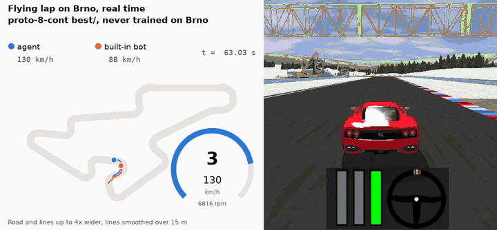
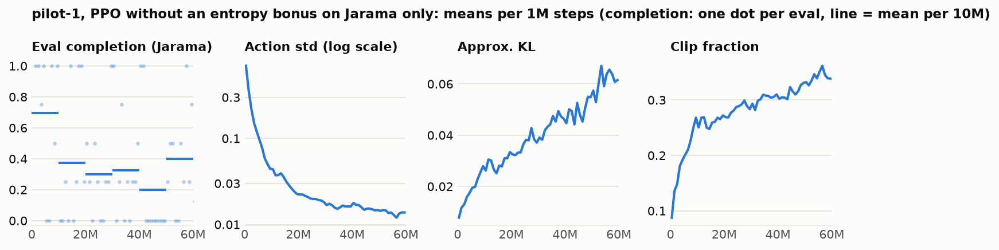

# rlpilot


A PPO driver for a racing simulator (Speed Dreams, a TORCS fork), trained on 29 tracks and tested on tracks it has
never seen. The question is generalisation: can one policy drive a circuit it has never trained on? Over seven
300M-step runs, plus pilots and fine-tunes, I changed the observations, the reward, the action space and the
evaluation, and tried to make it generalise to held-out tracks.

## Result

`best/` of proto-8-cont (314M steps, one seed), 8 episodes of 2 laps per track on the stock car
([details](docs/results.md)):

| Tracks | Role | Episodes that drove both laps | Median lap 2 vs the built-in bot (lower is better)|
|---|---|---|---|
| 29 train | Trained on | 169 / 232 = **72.8%** | -6.7% (22 tracks with a finish) |
| 6 validation | Never trained on, but **they selected `best/`** | 23 / 48 = **47.9%** | -3.6% (4 tracks) |
| 6 test | Never trained on or used for any decision, evaluated once | 15 / 48 = **31.2%** | -3.7% and -5.6% (2 tracks) |

Steering is ~25x smoother since proto-7 (0.0038 vs 0.094 change per step), from rate-limited steering and penalties on the policy's own output. Exploration is held up by an entropy bonus and a floor on the action std, which turned into its own problem (finding 1).



*43 s of a flying lap on Brno (63-106 s into the lap) by the checkpoint in the table, replayed in the game from its
recorded controls, with the built-in bot's lap on the synced map. Brno is a validation track: never trained on, but it
helped select `best/`. Lap 2: 129.06 s against the bot's 136.14 s on its own lap 2. It's one of this checkpoint's best
held-out laps, not a typical one (31.2% on test). The map widens road and lines up to 4x and smooths lines over 15 m;
length and shape are to scale.*

## PPO findings

**1. Exploration collapsed and the fix is not perfect:** pilot-1 trained without an entropy bonus. Its best lap (112.6 s at 3M steps, bot 107.4 s) came early. Over the next 50M steps, action std
fell from 0.19 to 0.014, approx KL rose from 0.018 to 0.061 and clip fraction from 0.19 to 0.34, while eval completion
fell from 0.69 to 0.20-0.40 per 10M block: a near-deterministic, brittle policy. The fix was an entropy bonus,
`target_kl` 0.02, LR decay and a std clamp of [0.1, 0.5]. That clamp became the next problem: in proto-7 and proto-9.5, steering
std reaches the 0.1 floor within 20-30M steps and pedal std within 190-210M, and KL sits at about 0.028, just under
SB3's early stop at 1.5 x `target_kl`, until the LR decays. Training rollouts stay close to one trajectory. Replacing white
noise with gSDE (held, state-dependent noise) from step 0 failed: std pinned at its 0.2 cap, KL reached 0.09, and the
car learned to stand still (mean speed 10.5 m/s in the first 10M steps, 0.15 m/s by 30M).



**2. Horizons are very important for this task:** at 25 Hz, gamma 0.99 is a ~4 s horizon. proto-1 learned to take the first
corner of lap 2 flat out, because it arrives at full speed only once per episode (notes). Gamma 0.995 (~8 s) followed.
GAE lambda shortens the advantage further: with gamma 0.995, lambda 0.95 weighs about 0.73 s ahead (1/(1 - gamma x
lambda) steps) and 0.98 about 1.6 s, while braking decisions come 2-4 s before a corner. A probe on proto-7 showed the
critic does see crashes coming about 2 s out on training tracks (AUC 0.77-0.91), and that lambda 0.98 carries 1.5-2.3x
more crash signal 3-4 s out (notes). So lambda 0.98 went into proto-9, bundled with three other changes, and that run
can't attribute it.

**3. Selection bias is real, especially on brittle policies:** episodes are chaotic: a 3e-7 change in the actions flips crash vs
lap at a marginal corner. Between checkpoints ~6M steps apart, a median of 8 of the 35 non-test tracks change outcome.
The live dashboard's 4 monitored training tracks read 1.00 at 10 of proto-8-cont's last 12 evals, while the post-run
sweep put all 29 at 0.53-0.78 over the same stretch of training. And `best/`'s validation score is 47.9% against 31.2%
on the untouched test tracks. So `best/` comes from the best window of 3 evals rather than the best eval, runs are
compared on all 35 non-test tracks over a window of checkpoints, and the test split was spent once, at the end.

## Run history

One seed per run, several changes per run, no ablations yet: these rows say what happened, not why. Comparable numbers
are in [docs/results.md](docs/results.md).

| Run | What changed | What happened |
|---|---|---|
| pilot-1..5, proto-1/2 | Jarama only. Entropy, std clamp, gearbox as shift points, gamma | See findings 1 and 2. Every agent-shifting run learned to short-shift and stay in 5th, hence a shift-point action |
| proto-3 | 4 tracks, curvature lookahead (150M) | 9.9% faster than the bot on its 4 tracks, 0 laps on the 2 held-out tracks |
| proto-4 | 35 tracks, car randomisation (grip, mass, power ±10%) | Held-out completion 0.39. Steering limit cycle: sign flip every step |
| proto-5 | Steering-rate penalty, gamma 0.995, peak curvature | Limit cycle reduced. Laps +2.0% vs the bot (proto-4: -3.6%), held-out completion 0.30 |
| proto-6 | Bot's racing line as input + potential-based shaping | Best of proto-4..6 on training tracks (0.63), worst held-out (0.20). Zeroing the line inputs: 0 held-out laps. It leaned on a leak |
| proto-7 | Rate-limited steering increments, speed-scaled road edges replace the line, one worker per track, 29/6/6 split | Smooth steering (0.0038 per step vs 0.094). `best/`: 64.7% train, 47.9% validation |
| proto-8 | Random launches (70% of samples start anywhere on the lap, 0-105 km/h) | `best/` 72.8% / 47.9%. Late window barely moved vs proto-7 (0.68 vs 0.67 train, 0.35 vs 0.33 validation) |
| proto-9 | Road height, GAE lambda 0.98, looser off-track rules, terminal penalty 10 -> 50 | Slower and not safer: `best/` laps +4.0% vs the bot (proto-8: -6.7%), late window 0.36 / 0.09 under proto-8's rules. Terminal 50 is the prime suspect (untested) |
| proto-9.5 | Terminal back to 10, acceleration and termination-clock inputs | Pace back (-4.7% vs bot), late training completion 0.52, validation flat (0.21) |
| proto-9.5-sde2 | gSDE noise, std cap 0.2 | Never learned to drive (finding 1). Stopped at 171M |

What's next ([v2 notes](docs/v2-notes.md)): failures look like compounding errors off the one trajectory the policy
knows, so the plan is mistake learning (restarts from states just before failures) and an evaluation with more
perturbation than a deterministic lap.

## Generalisation, reward and evaluation

**Generalisation:** 
A Jarama-only policy crashed at the first heavy braking zone of every other track. In a probe,
telling it that it was 40% faster made it brake in only 3% of cases, while shrinking the forward rays triggered braking
(notes): it had learned "brake when the road looks like this", not "brake because I'm too fast". That led to multi-track
training, curvature lookahead, car randomisation, and later road edges spaced by speed (6 s ahead at the current speed),
so a corner appears earlier when the car is faster. proto-6's racing line was the bot's line on the very track being
driven, held-out tracks included: a leak, removed in proto-7. Random launches (proto-8) give the corners late in a lap
as many attempts as the first one.

**Reward** ([`reward.py`](python/rlpilot/reward.py), each component logged separately; proto-9.5 values):

| Component | Value |
|---|---|
| Progress | +0.1 per metre raced (0 with all 4 wheels off, from proto-9) |
| Off track | -0.05 per step, scaled by the fraction of wheels off |
| Damage | -0.001 per damage point |
| Failed episode | -10 (proto-9: -50) |
| Steering | -0.3 x \|change\| per step, -0.02 per reversal above a 0.015 dead-band |

- **Size the penalties against progress:** Progress is ~0.14 per step at mean speed. proto-5's
  steering-rate penalty came to ~0.3% of it and couldn't stop the jitter; proto-7's two terms come to 3-8%, checked in a
  smoke run against the terminal penalty too ([notes](docs/research-notes-proto7.md)).
- **A big terminal penalty bought slowness. It wasn't safer:** With gamma 0.995 at 25 Hz, the discounted future at 40 m/s is
  worth ~32 (0.1 x 40 m/s x 0.04 s per step, over ~200 steps), so -50 outweighs all of it. proto-9 got slower without
  finishing more.
- **Reward hacking:** A smoke run found the policy creeping off the grid and spinning across
  the start line backwards: the lap counter jumped a lap, and all the progress reward came from it, while the return
  looked fine. Progress now drops lap-sized jumps.
- proto-6's line shaping was potential-based (Ng et al. 1999), capped at 3 m and faded out by half the run.

**Evaluation:** Deterministic policy, stock car, 2-lap episodes, the first episode per track clean and the rest with
small action noise for 1 s. Lap times are compared with the built-in bot on the same track and car. `best/` is the best
eval of the best window of 3. A post-run report sweeps every saved checkpoint on the 29 training and 6 validation tracks
([`report.py`](python/rlpilot/report.py)) with a crash map per track, because the live eval covered 10 tracks until
proto-8. Runs compared across rule changes use the strictest rules.

## The simulator wrapper

PPO needs a lot of samples here: each run is 300M steps, and the experiments above took seven of them plus pilots. So the
environment had to be fast, and it was built with AI assistance (Claude Code): I set the requirements and checked the
measurements, and most of the C++ and shared-memory code was written by the assistant. In short, one headless C++
worker process per simulator, one shared-memory block, and one native call per vector step behind a Gymnasium
`VectorEnv`. Reward, termination and features stay in Python.

| | Steps/s | Source |
|---|---|---|
| Simulator alone, 5 workers, no Python (M1 Pro) | 167.5k | [benchmark log](docs/data/bench-2026-11-02.txt) |
| Full PPO training incl. evals, M1 Pro (proto-6) | 11.6k: 300M in 7 h 9 min | MLflow `116a8a86` |
| Full PPO training incl. evals, Ryzen 7 7700X + RTX 4070 Ti, CPU rollouts and GPU updates (proto-9.5) | 17.7k: 300M in 4 h 42 min | MLflow `cc2e6507` |

Design, protocol, benchmarks and engine gotchas: [docs/gym-wrapper.md](docs/gym-wrapper.md). Building the simulator on
macOS: [docs/speed-dreams-setup.md](docs/speed-dreams-setup.md).

## Status and limits

- **Reliability on new tracks is the open problem**: 31.2% on the test split.
- **One seed per run and bundled changes:** `--seed` doesn't reach the car and launch draws yet, which a multi-seed
  comparison needs first. Each run takes 5-10 h, so I prioritise runs over seeds
- **Builds on macOS (Apple Silicon) and Linux / WSL2**

## Quick start

Requires macOS 14.4+ on Apple Silicon with [Homebrew](https://brew.sh), or Linux (`build-linux.sh`), and
[uv](https://docs.astral.sh/uv/).

```sh
git clone --recurse-submodules https://github.com/benjidsv/rlpilot.git
cd rlpilot
./build-macos.sh

# Initialize the game's settings dir once. The race name doesn't exist on purpose:
# the game populates the dir, prints "No such race type" and exits.
./sd-install/games/speed-dreams-2 -lc "$PWD/sd-local/" -s init -x

.venv/bin/python -m pytest tests

# Tracks and their bot references (41 tracks), then a short run
.venv/bin/python scripts/download_tracks.py --categories circuit road gprix
.venv/bin/python scripts/setup_tracks.py
.venv/bin/python scripts/train_sb3.py --workers 5 --timesteps 2000000 --eval-every 100000
.venv/bin/mlflow ui --backend-store-uri sqlite:///mlflow.db
```

proto-8's command is in [research-notes-proto7.md](docs/research-notes-proto7.md) (proto-7's launch, plus
`--launch-share 0.7`), proto-9's in [proto-9-plan.md](docs/proto-9-plan.md). The tables and charts here rebuild from
the committed CSVs with `.venv/bin/python scripts/make_readme_figures.py` (`--export` re-exports them from a local
MLflow store). `scripts/eval_test_tracks.py <run id>` runs a run's `best/` on the test split, once.

## Repository

| Path | What it is |
|---|---|
| `python/rlpilot/` | Env (`vec_env.py`, `reward.py`, `features.py`, `track.py`, `splits.py`), SB3 adapter (`sb3.py`), tracking and evaluation (`tracking.py`, `evaluate.py`, `report.py`) |
| `scripts/` | Training, report, test split, benchmarks, track setup, lap recording, figures |
| `native/` | C++ worker host, robot shim, shared-memory protocol, client library, C benchmark |
| `docs/` | [Results](docs/results.md), [research notes](docs/research-notes-proto7.md), [proto-9 plan](docs/proto-9-plan.md), [v2 notes](docs/v2-notes.md), [wrapper](docs/gym-wrapper.md), [simulator build](docs/speed-dreams-setup.md) |
| `speed-dreams-code/` | Submodule: [my fork](https://github.com/benjidsv/speed-dreams-code) of [Speed Dreams](https://forge.a-lec.org/speed-dreams/speed-dreams-code), upstream plus build fixes and launch hooks |

I don't send these changes upstream: Speed Dreams' `NOAI.md` policy rejects AI-assisted contributions, and I used AI
tools on this project.

## License

[GPL-2.0-or-later](LICENSE), the same as Speed Dreams. Tracks, cars and other game assets come from the Speed Dreams
project and keep their own licences; this repo doesn't include them.
