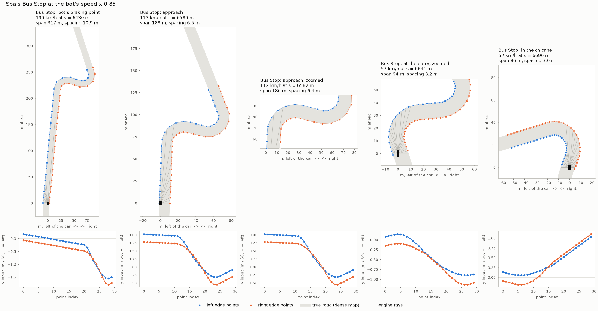
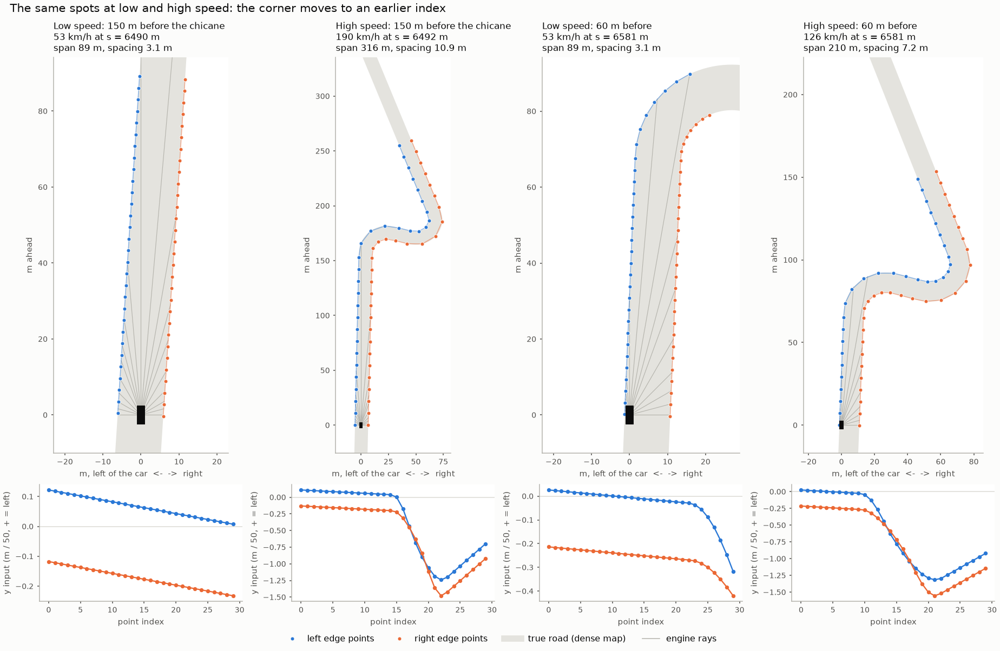
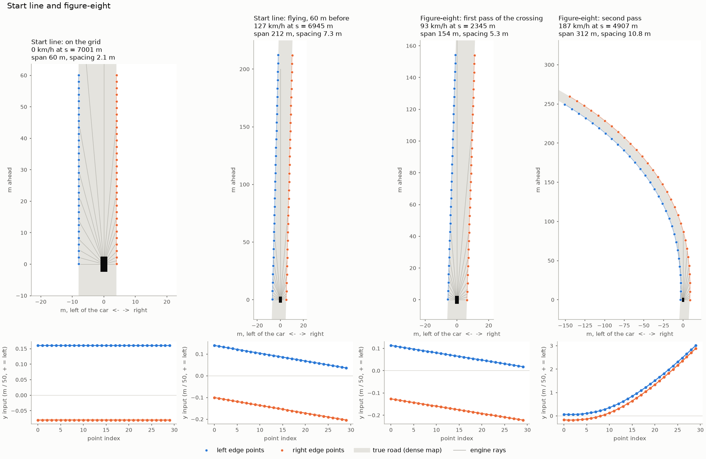
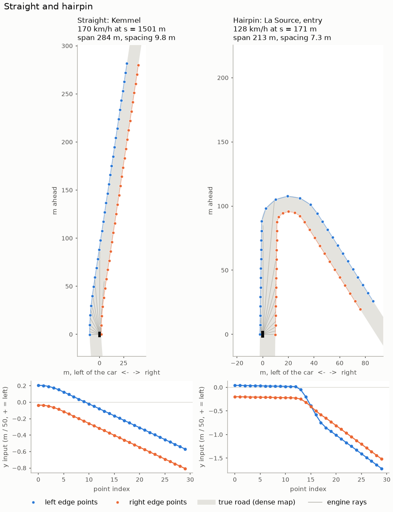

# Research notes, up to proto-7

Experiment log and plans. How the code works belongs in [gym-wrapper.md](gym-wrapper.md); what we tried, why, and what we decided belongs here.

## Goal

**True generalization.** Held-out completion comes first and pace second. Beating the bot is not the goal in itself, so per-track fine-tuning is out. Opponents wait until the car is fast and doesn't crash alone.

## Status (2026-11-03)

proto-6.5 is finished. proto-7 is **implemented and smoke-tested, not yet run or committed**. The launch command is at the end of "proto-7 implementation and smoke runs". The filter from proto-6.5 is gone.

## proto-6 probes and proto-6.5

**Goal: true generalization.** Held-out completion comes first and pace second. Beating the bot is not the goal in itself, so per-track fine-tuning is out: it would defeat the point. Opponents wait until the car is fast and doesn't crash alone.

**What proto-6 showed when probed in closed loop** (`best/`, 10 eval tracks, 8 episodes, official launch noise, 3-5 seeds, no retraining; the checkpoint was selected on these tracks, so its numbers are optimistic):

| Change at eval time | Completion, train / held-out | Pace vs bot, train / held-out | Steer change per step | Brake applications/s |
|---|---|---|---|---|
| None | 0.80 / 0.42 | -0.6% / +1.0% | 0.115 | 1.40 |
| Low-pass on steer (alpha 0.25) and pedal (alpha 0.5) | 0.70 / 0.43 | -1.75% / -0.7% (3 seeds) | 0.014 | 0.54 |
| Racing-line inputs zeroed | 0.33 / 0.00 | | | |
| Racing-line inputs replaced by the centreline | 0.09 / 0.00 | | | |

- **Jitter is an output problem.** Steer lock is 45 deg and the physics caps the wheels at 120 deg/s (0.107 of command per 40 ms step). 44% of the agent's steering changes exceed that cap, and above 60 m/s its median steering is 0.16 against the bot's 0.0005. The steer-rate penalty is ~0.3% of the progress reward at that level, so it can't fix it.
- **The filter has a cost the completion column hides.** Held-out progress falls from 1.15 to 0.87 laps (lap-2 crashes, e.g. Imola), and Braga goes from 0.2 to 0 completion. Lighter filters are not safer: steer alpha 0.5 does worse than 0.2-0.35.
- **Crashes are a separate problem.** The policy dies at the same corners with or without the filter. On Brno, Lombaro and Corkscrew it enters 15-40 km/h faster than the bot, often back on throttle, then runs wide. +36 km/h moves its pedal by only 0.06, so it is still largely blind to speed. Braga looks different (entry speeds are fine).
- **Ruled out:** exploration noise as the crash cause (steer sigma 0.1 barely lowers completion on the trained policy), wheel lock (0.8% of full-brake steps, so ABS is low priority), and the bot's setup (same gears, brake pressure 18500 vs 18000 kPa). The bot plans with `scale mu` 0.75, so it has margin.
- **The racing line is a leak we depend on.** On held-out tracks it comes from the bot driving that exact track, and proto-6 finishes no held-out laps without it. That is co-adaptation, not proof that a policy needs a line: proto-4 and proto-5 never had one (held-out 0.39 and 0.30 over their last 10 evals, against 0.20 for proto-6 on the same measure).

**Plan:**

1. **proto-6.5: fine-tune proto-6 `best/` with the filter** (`--resume`, 50M steps, ~70 min, LR 7e-5, the schedule's value at 256M). This tests whether the policy can recover the completion the filter costs, without a 7 h run. It keeps the racing line, because the checkpoint can't drive without it. Read it on the last 5 evals, on completion and progress together, against step 0 of the same run. `best/` is a selected peak, so some regression is expected. If the result is unclear, run the same fine-tune without the filter as a control.
2. **Restore a full car state** (engine fork patch, list of values: body, wheels, suspension, engine, gear, clutch, steering, tyres), so that a car can start from a saved agent state without the prestart. Pass/fail test: save a state, replay the same controls, compare the paths.
3. **proto-6.6: mistake learning on the fine-tuned policy, ~70 min.** Spawn from agent states 1-5 s before crashes, perturbed in lateral position, speed and heading, with difficulty adapted to keep survival around 30-70% per zone. Crash points come from training tracks only: using held-out evals would train on those tracks.
4. **Retrain without the racing line, ~7 h:** filter, spawns and the new score together, plus map-based spawns (any position and width, speed from curvature), because an agent from scratch has no snapshots past its first crash. To compare against proto-4 and proto-5 as well as proto-6. Whether this run also moves to a train/validation/test split is still open.

**proto-6.5 result** (MLflow 17831884..., 50M steps, one seed, last 5 evals against proto-6's last 10):

| | proto-6 | proto-6.5 |
|---|---|---|
| Train completion | 0.63 | 0.53 |
| Train progress, laps | 1.31 | 1.16 |
| Train pace vs bot | -0.85% | -2.85% |
| Held-out completion | 0.20 | 0.19 |
| Held-out progress, laps | 0.78 | 0.73 |
| Held-out pace vs bot, survivors only | +0.30% | -0.21% |
| Jarama `steer_delta` (proto-6.5: final eval) | 0.09 | 0.029 |

The filter stays: it is about 3x smoother and faster, with no measurable held-out loss. Fine-tuning did not lift completion, though. Train completion reached 0.97 at 4M (`best/`) and then fell, São Paulo stayed near 0 from 24M on, and `steer_delta` crept up from 0.013 to 0.029. Crashes keep happening at the same corners, and Spa and Brno never finished a lap. No no-filter control was run, so the slide can't be split between the filter and fine-tuning drift.

**Revised verdict on the filter (same day).** The result above read the filter as a win. Looking at what the policy requests shows otherwise (Jarama, clean episode, filter on):

| Checkpoint | Requested steer change | Applied steer change | Requested steer change, lag-1 correlation |
|---|---:|---:|---:|
| Step 0 | 0.059 | 0.014 | -0.43 |
| 10M | 0.076 | 0.015 | -0.56 |
| 30M | 0.130 | 0.022 | -0.65 |
| 50M | 0.169 | 0.029 | -0.65 |

(20M is left out: that episode crashed after 966 steps.)

- **The policy got more erratic behind the filter.** Requested steering chatter tripled and alternates more. The steer penalty only sees the applied value, so raw chatter is free, and the filter hides it. That was a design flaw in the filter.
- **The fine-tune wasn't gentle.** KL stayed at ~0.023 as in proto-6: a lower LR just runs more of the KL budget, because `target_kl` is unchanged.
- The filter's pace and smoothness at step 0 are real, but as a retrofit it isn't stable. Hence a design where the policy's own output is limited and penalized.

## What the Sony papers actually say

- **Nature 2022 (GT Sophy, QR-SAC):** absolute steering in [-1, 1] at 10 Hz, no substantial gain above 10 Hz. Course points on the left edge, centre line and right edge (60 equally spaced 3D points), spaced to span ~6 s of travel at the current speed, egocentric. Hand-tuned scenario ratios were not enough: random sampling "often led to skills being unlearned", and multi-table stratified sampling "to explicitly enforce proportions of each scenario in each training mini-batch" stabilized skill retention. Mistake learning launches training from the state shortly before a lost-control event. Time-trial training: 10 PS4s, ~8 days.
- **arXiv 2504.09021 (GT7, vision-based):** steering is a delta in [-3, +3] degrees per 10 Hz update, linearly interpolated over the 60 Hz ticks, with zero-order hold on the pedal. Penalties: steering change `-|theta_t - theta_t-1|` and a history term that fires when consecutive deltas both exceed a dead-band and reverse sign. Observes steering angle and changes over the last 3 steps. No pedal smoothness term and no stratified replay in this paper. Its 6 s track points are critic-only, because the actor drives from vision.

## Measurements for the design

- **Steering limit from the bot** (cached reference laps, some tracks twice, flying laps; 1.0 command = 45 deg):

| Limit | Per 40 ms step | Bot exceeds it |
|---|---:|---:|
| 30 deg/s (the GT7 rate) | 0.027 | 5.97% (8.88% at 20-40 m/s) |
| 56 deg/s | 0.050 | 1.39% |
| 70 deg/s | 0.0625 | 0.77% |
| 120 deg/s (the sim's own cap) | 0.107 | 0.18% |

  Post-hoc limits on proto-6: 0.05 per step still drives, 0.02 crashes. It's a co-adapted policy, so this is only a hint.
- **Track coverage in PPO.** No replay buffer, so a batch holds what the workers are driving now. 20 workers draw from 35 tracks with replacement and stay ~200k steps: on average 15.4 of 35 tracks are in the batch, a given track is absent 56% of the time, and the set lasts ~390 updates (4M steps, equal to proto-6.5's eval interval). Plausible cause of skills being forgotten between evals; **not verified**, because track assignments aren't logged.

## proto-7 (full run, agreed 2026-11-03)

1. **Steering increments.** Action = change of steering, bounded by a hard limit (start at ~70 deg/s, 0.0625 per step, sized from the bot). 25 Hz is kept and no worker change is needed: the sim's 500 Hz physics already slews moves of this size.
2. **Penalties on the policy's own output.** Steering change, plus a reversal penalty with a dead-band so exploration noise doesn't dominate it. Weights set relative to progress (~0.14 per step at mean speed); the old penalty was ~0.3% of it.
3. **Steering history in observations:** angle and changes over the last 3 steps.
4. **Remove the filter.**
5. **One worker per training track** (workers = tracks, n_steps so samples per update stay ~10k), so every update contains every track, with no respawns. The PPO version of stratified sampling; scenario ratios can later be set per worker at reset.
6. **Speed-scaled road geometry:** left and right edges, egocentric, ~6 s ahead, from the track map. It should expose speed to the policy (a corner appears earlier when faster) and replaces the bot's racing line, removing that leak.
7. **Metrics:** log requested and applied changes separately, and track assignments.

Compared against proto-4 and proto-5 (no racing line) as well as proto-6. If it beats them substantially, run ablations to find out which changes did it.

**After proto-7:** snapshot restore and mistake learning, as a fine-tune from proto-7 with a lower `target_kl`, then a new full run if it helps. Real stratified replay needs an off-policy algorithm (QR-SAC or TQC); deferred.

### Implementation notes

**Split (29 train / 6 validation / 6 test).** Validation = the current held-out tracks (Imula, ardennen-spa, brno, corkscrew, lombaro, street-1), which select checkpoints. Test = alicante, atlanta, auriac, brondehach, nordschleife, spring: drawn before any proto-7 result, with `random.Random(20261103).sample(sorted(proto-6 train tracks minus jarama, braga, sao-paulo, petit), 6)`. Don't redraw, even though it picked the two longest tracks. Test tracks never select anything: evaluate them only on the final `best/`, with a separate script, not in the training evals. They were trained on in proto-4/5/6, so no test comparison with those runs exists.

**Steering.** `steer_t = clip(steer_t-1 + action x limit, -1, 1)`, limit 0.0625 per 40 ms step, 0 at episode start. Pedal stays absolute, gearbox `points` unchanged. Remove the action filter and its flags. Keep `--resume`.

**Penalties.** On the applied change (now the policy's own output): `-w1 x |change|`, and `-w2` when consecutive changes reverse sign and both exceed a dead-band. With the 0.1 std floor, noise is ~0.006 per step, so start the dead-band around 0.015. Set the weights from a short smoke run against `reward/progress`, logged as separate components, and check they neither dwarf the terminal penalty nor stay negligible.

**Observations.** Steering angle and the changes over the last 3 steps. Edges: `--edge-obs`, left and right borders in the car's frame, ~30 points per edge spanning 6 s at current speed with a floor distance, from the borders already cached in `reference/` (Python only, 2D, as `track.py`). Remove `--line-obs` and `--line-shaping` from the run, not necessarily the code (`line_dev` stays as a metric). Keep rays and curvature lookahead. Check 30 points resolves Spa's Bus Stop, and measure throughput before raising the 256x256 net.

**Workers.** One per training track: 29 workers, `n_steps` 353 (~10.2k samples per update). Worker i keeps its track; today a respawn draws a random one in `vec_env.step`, so recycling must keep the same track. Check memory and throughput (eval adds 80 workers on a 16 GB machine).

**Metrics.** Log requested and applied changes separately. Check the score still reads sensibly, with validation tracks counted in it.

**Order.** Tests, smoke run, `scripts/bench_env.py`, then launch 300M under `caffeinate` with the same flags as proto-6 otherwise (seed 1, `--car-random 0.1 --car-obs --min-std 0.1 --max-std 0.5`, `--eval-every 8000000`).

Launch long runs under `caffeinate -is`, on AC with the lid open: the Mac slept through ~90 min of proto-6.5, and closing the lid sleeps it anyway.

### proto-7 implementation and smoke runs (2026-11-03, nothing committed)

**Differences from the notes above:**

- **Fixed a reward exploit the first smoke run found.** `dist_raced = (laps - 1) x length + dist_from_start` jumps a whole lap when a car crosses the start line backwards: the engine doesn't count a lap, but `dist_from_start` wraps. The policy learned to creep off the grid, spin at full lock across the line and collect it: at 3M steps, 38% of steps at lock, 4 m/s, first gear, 67% of episodes ending `backwards`, and **all** of the positive progress reward came from these jumps. Progress now drops anything lap-sized, and the `progress` and `dist_raced` stats use the same corrected distance. The bug is as old as the reward, but it doesn't appear to have been exploited before: 0 of 1,141 per-track evals in proto-4/5/6/6.5 failed just before the line, and their speeds are normal. Their numbers stand.
- **`--recycle-resets 1000`, not the default 2000.** See memory below.
- **Distances along the map are anchored at the engine's lap length, not rescaled to it** (edge points only). Imola's map doesn't close: rescaling spreads a 3 m error over the lap, against 0.18 m at p99 when anchored. `TrackProfile` keeps its rescale, so that the lookahead stays comparable with earlier runs.

**Design choices made while implementing, to challenge if wrong:**

- **Scales:** edge x / 100 m, y / 50 m, not clipped. Measured over the bot's laps on all 41 tracks: |x| p99 337 m, max 464 m; |y| p99 146 m, max 245 m. In smoke-2 the inputs stayed within +-4.3.
- **Point placement:** index 0 is abreast of the car (a measuring point: it equals `to_left`/`to_right`), index 29 at the span. Span = max(6 s x speed, 60 m), with speed the horizontal magnitude, so a sliding car still looks far enough ahead.
- **Penalties at the lock:** they use the applied change, as specified, so pressing into the lock is free. `steer_requested` and `steer_lock_frac` show it if it happens. It was 0.5% of steps in smoke-2.
- **`prev_steer` in the observation is the steering command itself**, in both modes. The other pedal and gearbox previous actions are unchanged.

**Penalty weights: `--steer-change 0.3 --steer-reversal 0.02 --steer-deadband 0.015`.** From smoke-2 (5M steps), against a progress of 0.14 per step at mean speed:

| | Per step | % of progress | Per episode, early (std 0.5) | Per episode, late (5M) |
|---|---:|---:|---:|---:|
| Change, `0.3 x |change|` | 0.0037 at 5M, 0.0072 at the start | 2.7%, 5% | -1.7 | -10.0 |
| Reversal, 0.02 when fired | 0.0008 at 5M (fires on 4.1% of steps), 0.0039 at the start (19.6%) | 0.6%, 3% | -0.9 | -2.3 |
| Terminal, for comparison | | | -10 | -8.1 |
| Progress, for comparison | | | 0.8 | 431 |

Compared with the old penalty's ~0.3% of progress, this is about 10 times stronger, and it neither dwarfs the terminal penalty early (-2.7 vs -10) nor swamps progress late (3%). Saturated chatter would pay 0.039 per step, 28% of progress. At the 0.1 std floor a reversal needs two ~2.4 sigma moves of opposite sign in a row, ~1e-4 of steps, so noise doesn't trigger it. Only one setting has been tried: these are checked, not tuned.

**Pedals.** Unchanged from proto-6, as agreed: the action is the pedal position directly, with no increments, limit or penalty, and the observation has only the previous value. The filter that proto-6.5 put on them is gone. Requested and applied pedal are therefore the same, and `behavior/pedal_delta` is logged (0.197 per step in training at 3-5M, 0.015 in eval). The reasoning: the GT7 paper has no pedal smoothness term either, and steering was the measured problem. But proto-6 did flick its brake 1.40 times/s, and the filter's 0.54/s came with pace gains, so this is the obvious next thing to look at if the run comes out smooth in steering and jerky on the pedals.

**What the policy sees** (`scripts/plot_obs.py`, real engine state read back through the layout, in the car's frame over the true road; the car faces up, blue is the left edge, orange the right, thin lines are the rays; below each panel, the inputs the network gets):

Spa's Bus Stop, at the bot's speed x 0.85:



The same spots at low and high speed. At 60 m before the chicane, the corner starts near index 24 at 53 km/h and near index 11 at 126 km/h; at 150 m it is out of view at 53 km/h:



The start line (no gap across it, from the grid or flying) and Karwada's crossing (each pass sees only its own branch):



A straight and a hairpin:



**Bus Stop: 30 points resolve it.** From the bot's braking point at 229 km/h, 7 points fall in the chicane and all three direction changes are visible. The worst distance from the true edge to the line through the points, along the bot's own approach, on a ~12 m wide road (`plot_obs.py` prints this):

| Car at (m) | To the chicane (m) | Bot, km/h | Span (m) | Spacing (m) | Points in the chicane | Worst error, 30 points (m) | With 60 points (m) |
|---:|---:|---:|---:|---:|---:|---:|---:|
| 6300 | 340 | 220 | 367 | 12.6 | 4 | 1.47 | 0.44 |
| 6430 | 210 | 229 | 381 | 13.1 | 7 | 1.79 | 0.51 |
| 6500 | 140 | 191 | 318 | 11.0 | 9 | 1.28 | 0.39 |
| 6560 | 80 | 147 | 245 | 8.4 | 11 | 0.82 | 0.26 |
| 6600 | 40 | 112 | 187 | 6.5 | 14 | 0.51 | 0.17 |
| 6630 | 10 | 80 | 134 | 4.6 | 20 | 0.26 | 0.1 |
| 6660 | -20 | 53 | 88 | 3.0 | 23 | 0.13 | 0.07 |
| 6690 | -50 | 62 | 103 | 3.5 | 12 | 0.17 | 0.07 |

60 points would cut the error about 3.5x, at 240 edge inputs instead of 120. They'd matter more for a precise line through it than for seeing it in time, so 30 stays unless a run shows otherwise.

**How it was checked** (`tests/test_obs.py`, 89 tests passing in the whole suite, ~1 min):

- Known answers: a straight and a constant-radius circle give the exact edge points. A corner reaches the expected index at each speed, and the span uses the floor near standstill.
- Engine agreement: world-frame position and yaw checked from the car's motion, not assumed.

| Check | Measured | Test bound |
|---|---|---|
| Nearest edge points vs `to_left`/`to_right` | 3 cm at p99, 0.8 m worst (Imola's seam) | 5 cm p99, 1 m worst |
| Edge points vs rays | 0.2 m at p99 | 0.25 m p99 |
| Lap distance vs engine, all 41 tracks | 0.32 m p99, 3.05 m worst (Imola's seam) | 0.5 m p99, 3.5 m worst |

- Signs in left and right corners and with the car offset both ways; lap wrap including the grid and Karwada; first observations and `final_obs` across same-step autoreset; partial batches; recycling keeps the track and its tables; steering exact against the shared-memory slot and the engine's recorded car control; penalties against hand-computed sequences; determinism; scrambling the bot's line changes no input or reward.
- The tests caught three of my own mistakes on the way: a crash in `train_sb3.py`'s help text, a claimed 5-sample last minibatch (it is 2045: n_steps 353 is fine), and a U-turn test that didn't actually cross the line.
- Code review of the final diff: 8 of 10 findings fixed, including the README's proto-6 command (now needs `--track-switch-steps 200000`), a test-track guard that could never fire, and test results only going to stdout. The raw `dist_raced` in traces still has the lap jump; no metric reads it.

**Observation ranges in smoke-2** (rollout at ~4M steps, `obs/*` metrics; none non-finite):

| Group | Min | Max |
|---|---:|---:|
| `edge_left_x` / `edge_right_x` | -0.37 | 4.0 |
| `edge_left_y` / `edge_right_y` | -4.3 | 4.2 |
| `steer_history` | -1 | 1 |
| `lookahead` | -2.47 | 2.47 |
| `speed` | -3.78 | 1.4 |
| `to_middle` | -4.2 | 1.5 |
| `rays` | 0 | 1 |

**Throughput and memory (M1 Pro, 16 GB, same code, same session):**

| | proto-6 flags | proto-7 flags |
|---|---:|---:|
| Workers, observation size | 20, 55 | 29, 170 |
| Whole PPO loop, steps/s (1M steps, mean after 200k) | 8,670 | 8,534 |
| Env only through the SB3 adapter, scripted driver, steps/s | 35,209 | 37,908 |
| Worker footprint, fresh | 0.93 GB | 1.28 GB |
| + 0.1425 MB per reset per worker: peak at 2000 resets | 6.6 GB | **9.5 GB** |
| Peak at 1000 resets | | 5.4 GB |
| 80 eval workers | 3.54 GB | 3.65 GB |

Early on all workers reset at about the same rate, so they peak together around 5-6M steps. At 2000 resets that is ~13 GB of workers before Python and the OS on a 16 GB machine, hence 1000: the respawn costs ~0.4 s, it behaves exactly like a reset (tested), and there are few of them once episodes get long. Expect ~10 h for 300M plus ~38 evals. That's more than the 7-9 h the plan assumed.

**Smoke-2** (`proto7-smoke-2`, MLflow 340784cf..., 5M steps, one seed, evals every 1M). Not comparable to a finished run, but it does say the design works:

| | 1M | 2M | 3M | 5M |
|---|---:|---:|---:|---:|
| Train completion (4 tracks) | 0 | 0.50 | 0.50 | 0.53 |
| Validation completion (6 tracks) | 0 | 0.31 | 0.50 | 0.46 |
| Validation progress, laps of 2 | 0.21 | 0.90 | 1.14 | 1.16 |

For comparison, at 6-10M: proto-5 had train / held-out progress 1.25 / 0.97, proto-6 0.35 / 0.33, against 1.36 / 1.18 here at 5M. So this is ahead of proto-6 and in line with proto-5's early peak, which it then lost: an early eval can't show whether this lasts. The tracks differ too (proto-5 trained on 35, this on 29). In the final eval, **Spa's Bus Stop is passed**: Spa completes, 2.7% off the bot. Brno, Corkscrew, Jarama and São Paulo complete as well; Imola (0.17 laps), Street-1 (0.36), Braga (0.65), Petit (0.78) and Lombaro (0.83) don't. `behavior/steer_delta` falls from 0.024 to 0.012 (proto-6: 0.2-0.3 at this stage), and eval steering changes by 0.002 per step (proto-6 at its end: 0.09). Requested and applied changes match (0.0128 vs 0.0125), with the action at its limit on 1.5% of steps. Every update had all 29 tracks, at 353 samples each. `proto7-smoke-1` is the exploit run; don't read it as a result.

**Known limits to keep in mind when reading the run:**

1. **Eval's completion looks all-or-nothing.** The launch noise of 0.1 on the steer action used to be 0.1 of steering; under increments it is 0.006 per step. In smoke-2, 93% of per-track completions are exactly 0 or 1 (proto-6: 69%), so 8 episodes per track may act like one. Raising it is **not** the fix, though. On smoke-2's `best/`, 3 seeds each on all 10 tracks: at the current noise and with steering noise raised to 0.32 (~0.1 of steering after 1 s), every per-track completion is 0 or 1, and the same tracks pass and fail. Whatever decides those tracks isn't the launch, at least on this young policy. So eval stays unchanged, and comparable with earlier runs. Read a single eval as coarse, rely on `eval/score_smoothed`, and look at this again at the end: this checkpoint had 3M steps, and proto-6's spread came from a policy with 100 times the training.
2. **Pedal std stays high:** 0.38 at 5M while steering is at 0.17 (proto-6 had 0.27 on the pedal at that stage). Worth watching.

**Launch:**

```sh
caffeinate -is .venv/bin/python scripts/train_sb3.py --split proto7 --workers 29 --n-steps 353 --gearbox points --lookahead \
  --car-random 0.1 --car-obs --min-std 0.1 --max-std 0.5 --seed 1 --steer-limit 0.0625 --steer-history 3 --steer-rate 0 \
  --steer-change 0.3 --steer-reversal 0.02 --edge-points 30 --recycle-resets 1000 --timesteps 300000000 --eval-every 8000000 \
  --run-name proto-7
```

Then, once only, on the final `best/`: `scripts/eval_test_tracks.py <run id>`.
