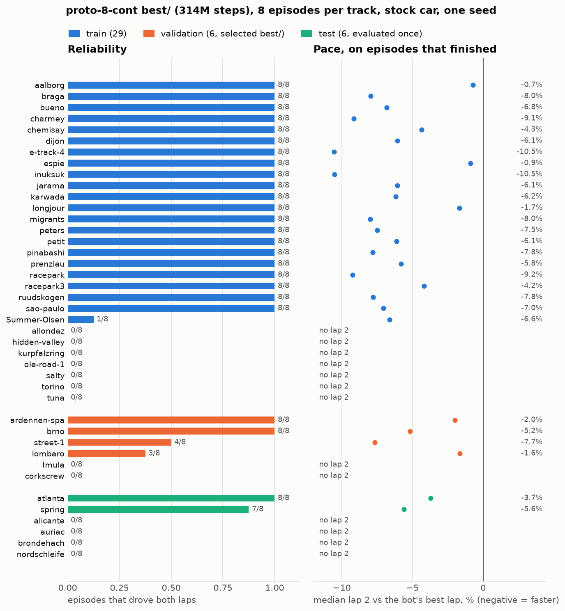

# Results

Every number on this page comes from a CSV in [`data/`](data/) or names the MLflow run it comes from. The CSVs are
written by `scripts/make_readme_figures.py --export` from the local MLflow store (desktop runs merged in on 2026-11-11)
and from `scripts/report.py`'s sweeps. "Notes" marks numbers from probes whose scripts weren't kept: they can't be
re-derived from this repo.

## Tracks and splits

41 tracks in total.

| Runs | Trained on | Evaluated on, never trained on |
|---|---|---|
| pilot-1..5, proto-1/2 | Jarama | |
| proto-3 | 4 | Imola, Spa |
| proto-4, 5, 6 | 35 | 6 held-out: Imola, Spa, Brno, Corkscrew, Lombaro, Street-1 |
| proto-7 and later | 29 | 6 validation (the same 6 as above) + 6 test: Alicante, Atlanta, Auriac, Brondehach, Nordschleife, Spring |

The test tracks were drawn before any proto-7 result (seeded draw, `python/rlpilot/splits.py`) and never select
anything. They were training tracks in proto-4/5/6, so there's no test number for those runs.

## Headline: proto-8-cont `best/`

MLflow run `b60db21f2534453685ee010e315a5584`, `best/` at step 314,001,531. 8 episodes per track of 2 laps each, the
first without launch noise, stock car, deterministic policy. "Finished" = drove both laps
([`report_by_run.csv`](data/report_by_run.csv), [`best_by_track.csv`](data/best_by_track.csv)).

| Split | Tracks | Finished | Median lap 2 vs the bot's best lap |
|---|---|---|---|
| Train | 29 | 169 / 232 = **72.8%** | -6.71% (median over the 22 tracks with a finish) |
| Validation (selected `best/`) | 6 | 23 / 48 = **47.9%** | -3.58% (4 tracks) |
| Test (once, 2026-11-11) | 6 | 15 / 48 = **31.2%** | Atlanta -3.72%, Spring -5.60% |

- **Validation is optimistic.** `best/` is the best window of 3 consecutive live evals, scored on 4 training tracks and
  the 6 validation tracks. The 47.9% on validation therefore includes selection. The test split is the only clean
  held-out number.
- **The test drop has two causes this can't separate:** selection on validation, and the test tracks being different
  tracks (they include the two longest, Nordschleife and Spring, bot laps 475.5 s and 557.5 s). One seed, 6 tracks.
- **Outcomes are per track, not per episode.** On test, 2 tracks pass (Atlanta 8/8, Spring 7/8) and 4 fail on all 8
  episodes. 6 tracks are closer to 6 samples than to 48.
- **Pace only exists for finished laps**, so it flatters tracks the policy rarely finishes.
- **The bot is a handicapped reference.** It runs simplix with its "skilling" handicap on. With it off, it was 2.0% and
  1.6% faster on the two tracks checked (Jarama 105.3 s vs 107.4 s, Braga 83.8 s vs 85.2 s; notes, in
  [gym-wrapper.md](gym-wrapper.md)). It also uses its own car setup; the agent drives the default one.
- **Re-running the same protocol isn't bit-identical.** Launch noise is drawn per worker, and workers are grouped by
  track differently in the report and in the test script. A dry run of the test script on 6 training tracks reproduced
  the report on 5 of them; Summer-Olsen, a marginal corner, gave 4/8 against the report's 1/8.

### Where the CV numbers come from

| Claim | Source | Status |
|---|---|---|
| 300M+ steps | Every run from proto-4 on ran 300M; proto-8 + proto-8-cont reached 371.8M (MLflow `b60db21f`, last step 371,819,324) | Verified |
| 29 training tracks | `PROTO7_TRAIN` in `splits.py`; `report_by_run.csv` | Verified |
| 73% on training tracks | 169/232 = 72.8%, proto-8-cont `best/` | Verified (72.8% rounded) |
| 48% on the 6 held-out tracks | 23/48 = 47.9%, same checkpoint. These are the **validation** tracks, which selected `best/` | Verified, but selection-biased: the clean number is **31.2%** on the test split |
| Laps ~6% faster than the built-in bot | Median lap 2 vs the bot's best lap over the 22 training tracks with a finish: -6.71% | Verified on finished laps only, against a handicapped bot (see above) |
| 167k steps/s | C benchmark, 5 workers, no Python, M1 Pro (`bench-2026-11-02.txt`, median 167.5k) | Verified, but it's the simulator alone. Training ran at 11.6k (Mac) to 17.7k (desktop) steps/s |

## proto-7 to proto-9.5, same evaluation

All four use the 29/6 split and the same report sweep (`scripts/report.py`). `best/`: 8 episodes per track.
Late window: every saved checkpoint between 250M and 300M, 2 episodes per track. "Strict" applies the 1 s off-track and
backwards limits of the runs up to proto-8 to every run, since proto-9 loosened them
([`report_by_run.csv`](data/report_by_run.csv)).

| Run | MLflow | `best/` step | `best/` train, strict | `best/` validation, strict | `best/` lap 2 vs bot, train | Late train, strict | Late validation, strict |
|---|---|---|---|---|---|---|---|
| proto-7 | `0d567d90` | 296M | 150/232 = 0.647 | 23/48 = 0.479 | -5.77% | 0.667 | 0.333 |
| proto-8-cont | `b60db21f` | 314M | 169/232 = 0.728 | 23/48 = 0.479 | -6.71% | 0.679 | 0.354 |
| proto-9-cont | `0cfb244e` | 152M | 142/232 = 0.612 | 24/48 = 0.500 | +4.00% | 0.358 | 0.093 |
| proto-9.5 | `cc2e6507` | 280M | 149/232 = 0.642 | 10/48 = 0.208 | -4.73% | 0.523 | 0.208 |

Under their own, looser rules, proto-9-cont's `best/` finishes 155/232 and 32/48, and proto-9.5's 176/232 and 10/48.
proto-9-cont's `best/` at 152M looks lucky: Corkscrew finishes 8/8 there and 2 of 58 episodes across its other
checkpoints (notes).

**Checkpoints flip.** Between adjacent saved checkpoints of proto-8-cont (~6M steps apart, 2 episodes per track), a
median of 8 of the 35 training and validation tracks change outcome (range 3-16, 37 pairs; [`checkpoint_flips.csv`](data/checkpoint_flips.csv)).
proto-7, proto-9-cont and proto-9.5 have medians of 10.

**The live dashboard misled.** Up to proto-8 it monitored 4 training tracks. Over proto-8-cont's last 12 evals
(282-370M) `dashboard/train_completion` read 1.00 ten times and 0.75 and 0.81 the other two (MLflow `b60db21f`), while
the report's sweep of all 29 training tracks over its last 12 checkpoints (301-371M) read 0.53-0.78
(`reports/proto-8-cont-b60db21f/data/results.json`, local only, not committed). From proto-9 the live eval covers all
35 training and validation tracks.

## proto-3 to proto-6, live evals

Earlier evaluation, not comparable with the tables above: 4 monitored training tracks and the 6 held-out tracks (proto-3:
2), "completion" = at least 1 lap, mean over the last 10 evals ([`results_by_run.csv`](data/results_by_run.csv)).

| Run | MLflow | Trained on | What changed | Completion, monitored training tracks | Pace vs bot, training | Completion, held-out | Pace vs bot, held-out |
|---|---|---|---|---|---|---|---|
| proto-3 | `1c4e0e2c` | 4 tracks | Curvature lookahead | 0.78 | -9.93% | 0.00 | none |
| proto-4 | `c9058ddd` | 35 | Car randomization | 0.48 | -3.65% | 0.39 | -2.54% |
| proto-5 | `88cf392d` | 35 | Steer-rate penalty, gamma 0.995, peak lookahead | 0.49 | +2.00% | 0.30 | +1.37% |
| proto-6 | `116a8a86` | 35 | Upshift hold, bot racing line (obs + shaping) | 0.63 | -0.85% | 0.20 | +0.30% |

proto-3 and proto-4 ran from an uncommitted tree (`git_dirty True`).

## Failures and what came of them

| Failure | What was measured | Status |
|---|---|---|
| Steering limit cycle (proto-4) | Deterministic steering flipped sign every step: final-eval `steer_delta` 0.69 on Jarama | Penalty in proto-5/6: 0.12, 0.09. Gone with rate-limited steering increments in proto-7: 0.0038 (MLflow `eval/driving/steer_delta`, runs `0d567d90` and `b60db21f`) |
| Gear hunting (proto-5) | ~20 up-then-down shifts per minute on Jarama (notes) | Upshift hold: ~4 per minute on proto-5's policy (notes), trained with from proto-6 |
| Spa's Bus Stop (proto-4..6) | The agent braked ~90 m later than the bot; even at the bot's entry speed it failed the chicane (notes) | Passed from proto-7 on: Spa finishes 8/8 at proto-8-cont `best/` |
| Lethal corners (proto-7, 8) | 10 of 12 crash corners at proto-8 `best/` were taken 20%+ above the bot's speed 100 m out (notes, [proto-9-plan.md](proto-9-plan.md)) | Open. With the off-track limit raised from 1 s to 20 s and no retraining, 18 of the 41 strict failures recovered and finished: part of "lethal" was the rule |
| Racing-line dependence (proto-6) | Zeroing the bot's line inputs: held-out completion 0.42 -> 0.00 (notes) | Line removed in proto-7, replaced by speed-scaled road edges |

### Input jitter (proto-6)

The README's earlier replay lap (proto-6 `best/`, 256M, Jarama; recording kept in `replay/jarama-proto6/`): steering changes 0.135 per control step against the bot's 0.009,
crosses centre 11.1 times per second against 1.6, and the brake is applied 2.1 times per second against 0.4
([`input_jitter.csv`](data/input_jitter.csv), bot sampled at the agent's 25 Hz). proto-7's steering increments fixed the
steering part (above).

## Fine-tunes

| Run | MLflow | What | Result |
|---|---|---|---|
| proto-6.5 | `17831884` | 50M from proto-6 `best/`, low-pass filter on the actions | Smoother and faster, but the policy's requested steering got 3x more erratic behind the filter. Dropped |
| proto-7-control / proto-7-launch | `b672c228` / `8b701896` | 50M from proto-7, without / with random launches | Validation 0.25 -> 0.53 at the end of the launch run, but the control crashed at 21.9M, so the late gain can't be separated from more fine-tuning. The full run (proto-8) didn't reproduce it |

Details: [research-notes-proto7.md](research-notes-proto7.md), [proto-9-plan.md](proto-9-plan.md).
